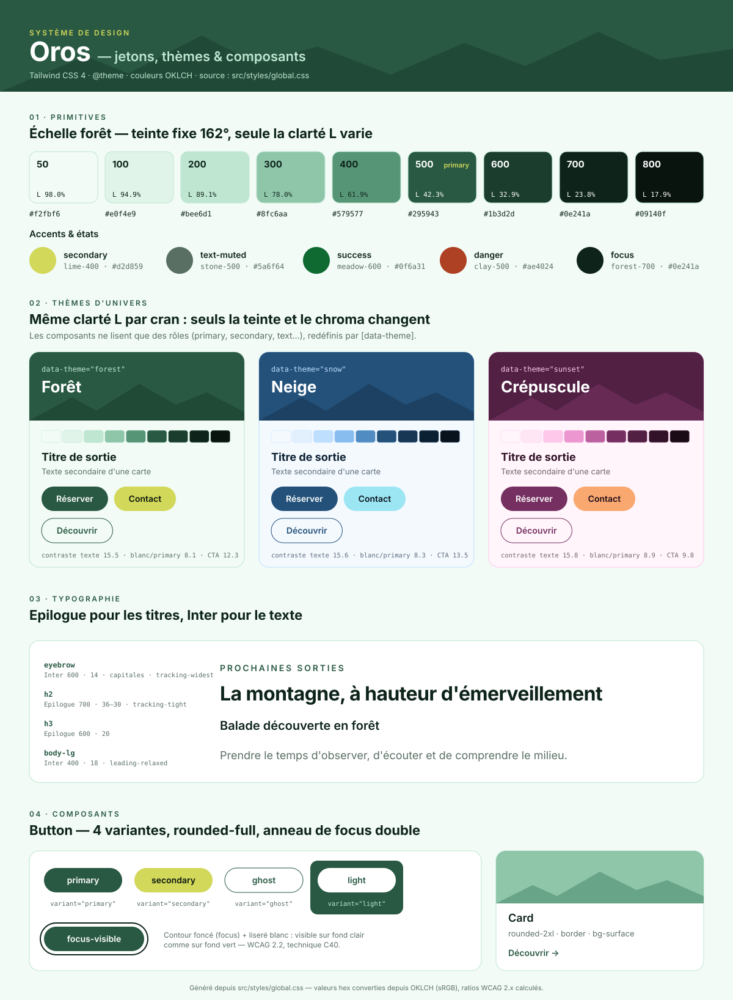
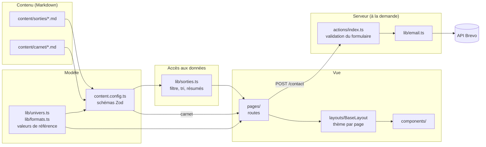

# Oros — site vitrine d'accompagnateur en montagne

Site vitrine de mon activité d'accompagnateur en moyenne montagne (stagiaire AMM) : présentation des sorties, d'un carnet de récits et d'un formulaire de contact.

> « Oros » (ὄρος, *montagne* en grec ancien) est un nom de travail.

Le projet sert aussi de terrain d'application à ma pratique d'ingénieur IHM : contenu typé et validé au build, accessibilité (WCAG 2.2) pensée dès le modèle de données, système de couleurs conçu pour garantir les contrastes, et JavaScript client réduit au strict nécessaire.


---

## Sommaire

- [Oros — site vitrine d'accompagnateur en montagne](#oros--site-vitrine-daccompagnateur-en-montagne)
  - [Sommaire](#sommaire)
  - [Stack technique](#stack-technique)
  - [Design System](#design-system)
  - [Animation](#animation)
  - [Architecture](#architecture)
    - [Plan du site](#plan-du-site)
  - [Structure du dépôt](#structure-du-dépôt)
  - [Choix de conception](#choix-de-conception)
    - [Un contenu typé, validé au build](#un-contenu-typé-validé-au-build)
    - [Une source unique de vérité](#une-source-unique-de-vérité)
    - [Séparer le thème de l'univers](#séparer-le-thème-de-lunivers)
    - [Des couleurs conçues pour les contrastes](#des-couleurs-conçues-pour-les-contrastes)
    - [L'accessibilité dès le modèle de données](#laccessibilité-dès-le-modèle-de-données)
    - [Robustesse du formulaire](#robustesse-du-formulaire)
    - [Détails de localisation](#détails-de-localisation)
  - [Démarrer en local](#démarrer-en-local)
  - [Ajouter du contenu](#ajouter-du-contenu)
    - [Une sortie](#une-sortie)
    - [Un article du carnet](#un-article-du-carnet)
  - [Evaluation du systeme](#evaluation-du-systeme)
    - [Echelle UX](#echelle-ux)
    - [Présentation des résultats](#présentation-des-résultats)
      - [Le diagramme des valeurs moyennes](#le-diagramme-des-valeurs-moyennes)
      - [Diagramme des paires de mots](#diagramme-des-paires-de-mots)
      - [Portfolio des résultats](#portfolio-des-résultats)
  - [Auteur](#auteur)

---

## Stack technique

| Rôle | Outil |
| :--- | :--- |
| Framework | [Astro 7](https://astro.build) — rendu statique par défaut, rendu serveur à la demande |
| Langage | TypeScript |
| Styles | [Tailwind CSS 4](https://tailwindcss.com) (`@theme`, couleurs en OKLCH) |
| Contenu | Markdown + [Content Collections](https://docs.astro.build/en/guides/content-collections/) validées par Zod |
| Formulaire | [Astro Actions](https://docs.astro.build/en/guides/actions/) (validation côté serveur) |
| E-mail | API transactionnelle [Brevo](https://www.brevo.com) |
| Exécution | Adaptateur [`@astrojs/node`](https://docs.astro.build/en/guides/integrations-guide/node/) en mode `standalone` |
| Polices | Epilogue, Inter — via l'API Fonts d'Astro (Fontsource) |

---

## Design System

Le design system du projet respecte les recommandations WCAG 2.X de l'académie W3C.



---

## Animation

Les animations dans le site web ont été réalisées avec tailwind CSS animation:

```css
  /* Animation */
  /* Apparition douce : fondu + légère montée. « both » garde l'élément
     caché pendant son délai, puis visible une fois l'animation finie. */
  --animate-apparition: apparition 3s cubic-bezier(0.22, 1, 0.36, 1) backwards;

  @keyframes apparition {
    from {
      opacity: 0;
      translate: 0 0.75rem;
    }
  }
```

et les animations au déclenchement du scroll ou sur DOM ont été réalisées grâce à la librairie [GSAP](https://gsap.com/) qui est une librairie d'animation JS. 
J'ai notamment utilisé les actions de déclenchement (scrollTrigered) du scroll de la souris, afin que les animations apparaissent à la vue de l'utilisateur.

```typescript
      gsap.from("[data-valeur]", {
        opacity: 0,
        y: 24,
        duration: 0.5,
        ease: "power2.out",
        stagger: 0.12, // les blocs arrivent l'un après l'autre
        scrollTrigger: {
          trigger: blocValeurs,
          start: "top 80%",
          once: true,
        },
      });
```

---

## Architecture

Le site est **hybride** : toutes les pages sont générées au build en HTML statique, sauf `/contact`, rendue à la demande (`prerender = false`) pour traiter l'envoi du formulaire.



Le flux se lit de gauche à droite :

1. **Contenu.** Une sortie ou un article est un fichier Markdown. Le frontmatter contient les données structurées (prix, dénivelé, programme, départs…) ; le corps contient le texte libre.
2. **Modèle.** `content.config.ts` décrit chaque collection avec un schéma Zod. Les énumérations (univers, formats, niveaux) viennent de `lib/`, si bien qu'une valeur inconnue dans un fichier Markdown **fait échouer le build** au lieu de produire une page cassée.
3. **Accès aux données.** Les pages n'appellent pas `getCollection` directement : elles passent par `lib/sorties.ts`, qui gère en un seul endroit l'exclusion des brouillons, le tri et les résumés affichés sur le hub.
4. **Vue.** Les routes dynamiques (`/sorties/[univers]/[slug]`, `/carnet/[slug]`) sont générées par `getStaticPaths`. `BaseLayout` applique un thème visuel via `data-theme`.
5. **Serveur.** Le formulaire de contact est envoyé à une Astro Action qui valide les champs, filtre les robots par *honeypot*, puis transmet le message à l'API Brevo (délai max. 10 s).

### Plan du site

| Route | Rendu | Contenu |
| :--- | :--- | :--- |
| `/` | statique | Accueil |
| `/sorties` | statique | Hub : univers et comparatif des formats |
| `/sorties/[univers]` | statique | Sorties d'un univers (`randonnee`, `hiver`, `itinerance`) |
| `/sorties/[univers]/[slug]` | statique | Fiche détaillée d'une sortie |
| `/groupes` | statique | Offre pour les groupes |
| `/carnet`, `/carnet/[slug]` | statique | Récits et conseils |
| `/qui-je-suis` | statique | Présentation |
| `/contact` | **serveur** | Formulaire de contact |

---

## Structure du dépôt

```text
src/
├── actions/          # Astro Actions (logique serveur du formulaire)
├── assets/           # SVG décoratifs
├── components/       # Composants .astro réutilisables (cartes, en-tête, pied de page…)
├── content/
│   ├── carnet/       # Articles du carnet (.md)
│   └── sorties/      # Une sortie = un fichier .md
├── images/           # Images optimisées au build par <Image />
├── layouts/          # BaseLayout : <head>, thème, header/footer
├── lib/              # Logique pure, sans rendu
│   ├── email.ts      #   envoi via l'API Brevo
│   ├── formats.ts    #   formats, niveaux, formatage (prix, dates)
│   ├── navigation.ts #   liens du menu, source unique Header/Footer
│   ├── site.ts       #   réglages globaux (coordonnées)
│   ├── sorties.ts    #   accès aux données de la collection « sorties »
│   └── univers.ts    #   univers de sorties et thèmes visuels
├── pages/            # Routage par fichiers
├── styles/
│   └── global.css    # Design tokens (Tailwind @theme) et thèmes
└── content.config.ts # Schémas des collections
```

`lib/` ne dépend d'aucun composant : c'est là que se trouvent les règles du domaine, ce qui permet de les importer aussi bien depuis les schémas que depuis les pages.

---

## Choix de conception

### Un contenu typé, validé au build

Chaque sortie est contrôlée par un schéma Zod : types, bornes (`groupe.min ≤ groupe.max`, `prix.des ≤ prix.jusqua`, `departs.fin ≥ departs.debut`) et chemins d'images vérifiés. Une erreur de saisie devient une **erreur de build explicite**, pas un défaut visible en production.

### Une source unique de vérité

- Les listes de référence sont déclarées `as const`, et les types en sont dérivés (`(typeof UNIVERS)[number]`).
- Les tables associées sont typées `Record<Univers, …>` : si on ajoute un univers sans lui donner de libellé, de thème et d'icône, **TypeScript refuse de compiler**, comme avec un `switch` exhaustif.
- La navigation (`lib/navigation.ts`) alimente à la fois le Header et le Footer.
- Le hub `/sorties` calcule ses résumés (formats présents, prix minimum, thèmes) à partir du contenu publié : ajouter un fichier `.md` suffit à le mettre à jour.

### Séparer le thème de l'univers

Deux notions qu'on pourrait confondre sont gardées distinctes :

- le **thème** (`forest`, `snow`, `sunset`) est une ambiance visuelle, applicable à n'importe quelle page ;
- l'**univers** (`randonnee`, `hiver`, `itinerance`) est une catégorie de sorties qui apparaît dans les URL.

Chaque univers est associé à un thème, mais le thème `forest` sert aussi à la marque. Fusionner les deux notions aurait couplé l'apparence et le routage.

### Des couleurs conçues pour les contrastes

Les couleurs sont définies en **OKLCH**, un espace perceptuellement uniforme. Les trois palettes partagent les **mêmes valeurs de clarté (L)** à chaque cran ; seuls la teinte et la saturation changent. Les contrastes texte/fond vérifiés sur le thème principal (≥ 4,5:1, critère WCAG 1.4.3) restent donc valables pour les autres thèmes.

La palette par défaut de Tailwind est désactivée (`--color-*: initial`) : seuls les *tokens* sémantiques du projet (`primary`, `surface`, `text-muted`, `danger`…) existent.

### L'accessibilité dès le modèle de données

- Le texte alternatif des photos est **obligatoire dans le schéma** (WCAG 1.1.1) : une image sans `alt` fait échouer le build.
- Le focus utilise un anneau double contour foncé et liseré clair (technique WCAG [C40](https://www.w3.org/WAI/WCAG22/Techniques/css/C40)), visible sur fond clair comme sur fond coloré.
- Après l'envoi du formulaire, le `<title>` de la page change (« Message envoyé », « Erreur : … ») : c'est la première information annoncée par un lecteur d'écran au rechargement, une pratique recommandée par le [GOV.UK Design System](https://design-system.service.gov.uk/components/error-summary/).

### Robustesse du formulaire

- Validation côté serveur (longueurs, format d'e-mail) avec messages d'erreur en français, liés à chaque champ.
- Anti-spam par *honeypot*, sans CAPTCHA, qui serait un obstacle pour les utilisateurs (voir [W3C, *Inaccessibility of CAPTCHA*](https://www.w3.org/TR/turingtest/)).
- La clé d'API est déclarée dans le schéma `astro:env` en `secret` côté serveur : elle n'atteint jamais le navigateur.
- L'appel à Brevo est interrompu après 10 s ; le détail de l'erreur n'est journalisé que côté serveur.

### Détails de localisation

Prix, nombres et dates passent par `Intl` en `fr-FR` (espace insécable avant « € », séparateur des milliers). Le fuseau `Europe/Paris` est imposé pour que les dates de départ ne dépendent pas du fuseau de la machine de build.

---

## Démarrer en local

**Prérequis :** Node.js ≥ 24.22 (voir `.node-version`).

```sh
npm install
echo "BREVO_API_KEY=votre_cle" > .env
npm run dev            # http://localhost:4321
```

Variables d'environnement :

| Variable | Contexte | Rôle |
| :--- | :--- | :--- |
| `BREVO_API_KEY` | serveur, secret | Envoi des e-mails du formulaire de contact |

Commandes :

| Commande | Action |
| :--- | :--- |
| `npm run dev` | Serveur de développement |
| `npm run build` | Build de production dans `dist/` |
| `npm run preview` | Prévisualisation du build |
| `node ./dist/server/entry.mjs` | Lancement du serveur Node autonome après build |

---

## Ajouter du contenu

### Une sortie

Créer un fichier dans `src/content/sorties/`. Son nom devient la fin de l'URL : `balade-decouverte.md` → `/sorties/<univers>/balade-decouverte`.

```yaml
---
title: Balade découverte
description: Résumé court, repris sur les cartes et en meta description.
univers: randonnee        # randonnee | hiver | itinerance
format: demi-journee      # demi-journee | journee | itinerance | sur-mesure
niveau: facile            # facile | modere | soutenu | adapte
groupe: { min: 2, max: 8 }
prix: { des: 35 }
couverture:
  src: ../../images/sortie.jpg
  alt: Description de la photo (obligatoire)
brouillon: false
---

Texte libre de la fiche.
```

Le schéma complet, avec les champs optionnels (programme, départs, galerie, inclus…), est documenté dans [`src/content.config.ts`](src/content.config.ts).

### Un article du carnet

Créer un fichier dans `src/content/carnet/` avec `title`, `description`, `pubDate` et, si besoin, `tags`.

---

## Evaluation du systeme

### Echelle UX

Dans le cadre de ce projet, j'ai souhaité évaluer les impressions des utilisateurs sur le site web, de manière itérative tout au long de la vie du projet.
Lors de la mise en ligne de la première version, j'ai mis en place un questionnaire bien connu dans le domaine de l'évaluation de l'expérience utilisateur : le questionnaire **AttrakDiff**[1].

Ce questionnaire s'appuie sur la traduction française validée par *Carine Lallemand* et *Guillaume Gronier*[2][3].

[1]: Hassenzahl, M., Burmester, M. & Koller, F. (2003). AttrakDiff: Ein Fragebogen zur Messung wahrgenommener hedonischer und pragmatischer Qualität. In J. Ziegler & G. Szwillus (Eds.), *Mensch & Computer 2003. Interaktion in Bewegung* (pp. 187–196). B. G. Teubner. [ResearchGate](https://www.researchgate.net/publication/200085886_AttrakDiff_Ein_Fragebogen_zur_Messung_wahrgenommener_hedonischer_und_pragmatischer_Qualitat)

[2]: Lallemand, C., Koenig, V., Gronier, G. & Martin, R. (2015). Création et validation d'une version française du questionnaire AttrakDiff pour l'évaluation de l'expérience utilisateur des systèmes interactifs. *Revue européenne de psychologie appliquée*, 65(5), 239–252. <https://doi.org/10.1016/j.erap.2015.08.002>

[3]: Lallemand, C., Gronier, G. & Dugué, M. (2018). *Méthodes de design UX* (2ᵉ éd.). Eyrolles.

L'analyse des résultats est réalisé directement avec un script python qu'on retrouve dans [/data_analysis](/data_analysis) en lancant le script `analyse.py` qui s'occupe de lancer les autres scripts et qui range les résultats et les graphes dans des dossiers formatté tel quel: ddmmaaa_nX ou 'nX' correspond à l'échantillon statistique.

Toutes les données sont anonymisée.

### Présentation des résultats

Le questionnaire, aujourd'hui, est utilisé en tant qu'évaluation unique. C'est à dire qu'on évalue le système sans comparaison avec un autre ou sans comparaison avant/après le même système. On peut imaginer ce type d'évaluation dans un second temps.

Les personnes évaluées n'ont pas reçu de scénario préferentielle d'utilisation du système, ce qui rend les résultats parfois hétérogène et libre d'interpretation.

Le questionnaire **Attrakdiff** comprends 28 items répartis en 4 échelles différentes:

- L'échelle de **Qualité Pragmatique** (QP): Décrit l'utilisabilité du produit et indique le niveau de facilité perçue des utilisateurs à atteindre leurs buts.
- L'échelle de **Qualité Hédonique - Stimulation** (QH-S): Indique dans quelle mesure le produit soutient le besoin de simulation en proposant des contenus, fonctionnalités, styles
d'interaction nouveaux, intéressants et stimulants.
- L'échelle de **Qualité Hédonique - Identité** (QH-I): Indique dans quelle mesure le produit soutient une fonction sociale et communique une certaine identité de l'utilisateur.
- L'échelle d'**Attractivité globale** (ATT): Décrit la valeur globale perçue du produit basée sur la perception des qualités pragmatiques et hédoniques.

Les 28 items du questionnaire se présentent sous la forme de différenciateurs sémantiques (paires de mots contrastés) en échelle de Likert à 7 points. L'ordre de passation des items est standardisé. Les 28 items ont été séparé en 3 blocs de 9 ou 10 items afin d'augmenter la lisibilité du questionnaire.

Au début du questionnaire, les utilisateurs ont cette consigne:
> Dans le cadre d'un projet, je souhaiterais évaluer vos impressions sur le site web <www.orosens.fr>. Ce questionnaire se présente sous forme de paires de mots pour vous assister dans l'évaluation du système. Chaque paire représente des contrastes. Les échelons entre les deux extrémités vous permettent de décrire l'intensité de la qualité choisie.
>Ne pensez pas aux paires de mots et essayez simplement de donner une réponse spontanée. Vous pourrez avoir l'impression que certains termes ne décrivent pas correctement le système. Dans ce cas, assurez-vous de donner tout de même une réponse. Gardez à l'esprit qu'il n'y a pas de bonne ou de mauvaise réponse. Seule votre opinion compte !
>Toutes les informations sont anonymes. Les questions sont uniquement à des fin statistiques et ne servent pas à vous retracer. Vous êtes libres de vous exprimez comme vous le voulez, en positif comme en négatif.

Pour présenter les résultats Lallemand propose plusieurs diagrammes possible.

#### Le diagramme des valeurs moyennes

Il représente les valeurs moyennes des différentes sous-échelles de l'Attrakdiff présenté plus tôt. Les valeurs proches de la moyenne (zone entre 0 et 1) sont standards: elles ne sont pas négatives et signifie que le produit remplit son obectif sans avoir d'impact négatif. Toutefois, des améliorations sont possibles sur ces aspects pour créer une UX ou attractivité très positive.

Les valeurs en dehors de cette zone neutre (représenté ici par une zone neutre positive et une zone neutre négative) sont à considérer comme des points positifs ou négatifs du système.


Chaque point dans le graphique représente donc la valeur moyenne des réponses utilisateurs par sous-échelle. Les barres en bougies sont des barres d'erruer est sont calculé d'après [loi de Student](https://fr.wikipedia.org/wiki/Loi_de_Student). Les barres couvrent l'intervalle de confiance à 95% (IC 95%). Cette loi est utilisée car les tailles des échantillons sont petit pour l'instant et ne justifie pas l'utilisation de la loi normale pour le calcul de l'écart type et de l'indice de confiance. Si le nombre de participant à l'étude grossit, alors l'utilisation de la loi normale suffira au calcul.

Avec cet effectif, les résultats doivent être lus comme des tendances.

Pour résumer:
la barre d’erreur mesure la précision de la moyenne ; elle dépend du désaccord entre les gens (l’écart-type), et elle diminue avec la racine du nombre de participants. Plus il y a de participants, plus la barre d'incertitude diminue et plus la moyenne s'affine.

#### Diagramme des paires de mots

Il présente les valeurs moyennes pour chaque paire de mots.

Les items sont regroupés par sous-échelles et placés autour d'un continuum avec au centre la valeur neutre 0, ce qui permet de distinguer très rapidement quels aspects sont perçus comme négatifs et quels aspects sont perçus comme positifs.


Les valeurs extrêmes (entre -2 et -3 ou à l'inverse entre +2 et +3) sont particulièrement intéressantes. Elles montrent quelles dimensions sont critiques ou au contraire particulièrement positives, et appellent à des actions d'amélioration sur ces aspects.

On apperçoit sur notre diagramme qu'aucune paire n'est clairement négative. La seule moyenne sous zéro est la paire "prudent/audacieux" et est à -0.14. Comme dit précédement l'échantillon étant faible, peut être qu'il s'affinera avec l'augmentation de l'échantillon.

15 paires de mots sur 28 sont dans la zone extrême positive, avec une belle courbe pour la sous-échelle "Attractivité Globale".

**Echelle d'attractivité globale** jouie d'une solide moyenne avec des écart-type faible (0.5-0.7), ce qui signifie que les participants sont le plus d'accord entre eux que sur n'importe quelle autre sous-échelle.

A noter tout de même que cette échelle est la plus sensible au biais de désirabilité sociale, puisque la plupart des répondants actuelles me connaissent. Cependant, l'échelle a pour but de reflèter une impression d'ensemble plutôt qu'une qualité précise et pour le cas de mon système, je suis satisfait du résultat obtenu.

**Echelle de qualité pragmatique** est plutôt solide, sauf deux paires "imprévisible/prévisible" et "technique/humain". Pour la paire "imprévisible/prévisible" 9 personnes sur 14 ont répondu exactement 0, ce qui pourrait se traduire par une difficulté à appliquer ce mot à ce système et donc que les participants ne savent pas quoi répondre. Ce qui pour le cas de mon système ne me surprends pas et ne me choque pas non plus.

Pour la paire "technique/humain" c'est la paire la plus partagée de l'échelle avec un écart type de **1.48** contre 0.9 a 1.2 pour les autres. La aussi il peut s'expliquer par la différence sémantique des mots utilisées. Pour certain "Technique" peut être pris positivement (sérieux, compétent...), surtout pour un site d'accompagnateur, ce qui brouille l'interprétation de cette paire. Le participant qui à répondu "Technioque" au maximum a d'ailleurs dibbé des bites très positives partout ailleurs. Il y a donc fort à penser qu'il s'agissent, pour le participant, d'une affirmation positive.

**Echelle de qualité hédonique identité** possède elle un point fort, l'image professionnelle. "Professionnel" (2.57) et "de bon goût" (2.57) sont parmis les moyennes les plus hautes de tout le questionnaire, avec un **fort consensus** (écart-type 0.65, aucune note sous zéro). Pour un site d'accompagnateur, c'est une vrai réussite car la crédibilité fait réserver et assure une confiance.

Les paires "sociales" sont plus basses et plus dispersées, comme "me sociabilise" (1.43), "me rapproche" (1.29) avec un écart type de 1.73 le plus fort désaccord du questionnaire, "mintegre" (1.79) avec beaucoup de réponse à 0. Comme pour la paire "technique/humain" on peut faire l'hypothèse que ces mots s'appliquent mal à un site consulté seul.

**Echelle de qualité hédonique stimulation** possède un profil en deux temps. Un profil **haut** avec des mots comme "Créatif" (2.29) et "Captivant"(2.07), et un profil **bas** avec des mots comme "Original" (0.57), "Novateur" (0.64), "Nouveau" (0.71), Challenging (0.79), "Audacieux"  (-0.14) avec 5 notes négatives et 5 neutres.

On peut faire une lecture de ce résultat comme suit: le site est perçu comme intéressant mais classique dans sa forme. Ce qui n'est pas forcément un défaut, un site qui suit les conventions du web est plus facile à utiliser parce que les visiteurs passent la plupart de leur temps sur d'autres sites et attendent qu'il fonctionne de la même façon. Cela fait partie des 10 **Heuristique de Nielsen** 4.*"Consistency and standards"*

**Ce qu'il faut retenir (TLDR;)** 
Le profil des paires de mots (n = 14) ne présente aucune paire franchement négative. L’attractivité (ATT) et l’image professionnelle (« Professionnel », « De bon goût ») obtiennent les scores les plus élevés et les plus consensuels. En qualité pragmatique, le site est jugé pratique, clair et maîtrisable. L’échelle de stimulation (QH-S) présente un profil contrasté : le contenu est perçu comme créatif et captivant, mais la forme comme peu originale, peu novatrice et plutôt prudente. Plusieurs paires (« Prévisible », paires de socialisation, « Challenging ») recueillent de nombreuses réponses neutres, ce qui suggère qu’elles s’appliquent difficilement à un site vitrine. Compte tenu de l’effectif et du fait que la majorité des répondants connaissent l’auteur, ces résultats sont à considérer comme des tendances.

#### Portfolio des résultats

Dans cette représentation des résultats, les valeurs moyennes obtenues aux échelles hédoniques sont représentées sur l'axe vertical (avec en bas la valeur la plus basse, soit -3) et la valeur moyenne à l'échelle pragmatique est représentée sur l'axe horizontal (à gauche la valeur la plus basse).


:arrow_right: Qualité pragmatique (QP) "est-ce que le site m'aide à faire ce que je veux, facilement ?"
:arrow_up: Qualité hédonique (QH) "est-ce qu'il est agréable, stimulant, valorisant?"

La diagramme se compose de 9 cases, avec des frontières à -1 et +1. La case visée est "désiré" en haut à droit, il correspond à un produit à la fois utile et plaisant.

Le point bleu représente la moyenne du groupe.

Le rectangle représente l'incertitude sur cette moyenne.

Les points gris représente chaque participant.

Le portfolio (n = 14) place le site dans la zone « désiré » (QP = 1,72 ; QH = 1,48). Le rectangle de confiance à 95 % est entièrement contenu dans cette zone, ce qui permet de considérer ce classement comme fiable ; il s’est stabilisé à mesure que l’échantillon augmentait (n = 9, 12 puis 14). Individuellement, 10 participants sur 14 se situent dans la zone « désiré ». Les deux participants ayant la qualité pragmatique la plus faible sont aussi ceux qui ont signalé dans les questions ouvertes des difficultés concrètes (filtres peu utiles, prix non visible, densité du contenu). Le score hédonique (QH) masque toutefois un écart entre une identité élevée (QH-I = 1,97) et une stimulation plus modeste (QH-S = 0,99), visible sur le diagramme des valeurs moyennes. Ces résultats restent à interpréter avec prudence compte tenu de l’effectif et d’un possible biais de désirabilité sociale, la majorité des répondants connaissant l’auteur.

*Compte tenu de l’effectif et du fait que la majorité des répondants connaissent l’auteur, ces résultats peuvent être influencés par un biais de désirabilité sociale [Dell et al., 2012](https://dl.acm.org/doi/10.1145/2207676.2208589) et sont à considérer comme des tendances.*

---

## Auteur

**Clément Allavena** — ingénieur logiciel spécialisé IHM (master IHM, ENAC) et accompagnateur en moyenne montagne stagiaire.
