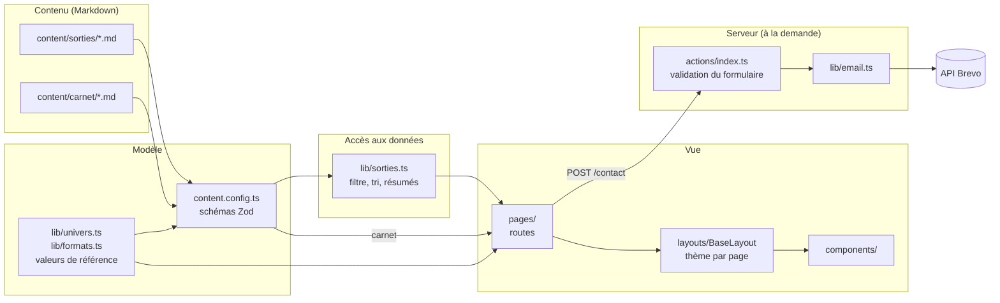

# Oros — site vitrine d'accompagnateur en montagne

Site vitrine de mon activité d'accompagnateur en moyenne montagne (stagiaire AMM) : présentation des sorties, d'un carnet de récits et d'un formulaire de contact.

> « Oros » (ὄρος, *montagne* en grec ancien) est un nom de travail.

Le projet sert aussi de terrain d'application à ma pratique d'ingénieur IHM : contenu typé et validé au build, accessibilité (WCAG 2.2) pensée dès le modèle de données, système de couleurs conçu pour garantir les contrastes, et JavaScript client réduit au strict nécessaire.


---

## Sommaire

- [Stack technique](#stack-technique)
- [Architecture](#architecture)
- [Structure du dépôt](#structure-du-dépôt)
- [Choix de conception](#choix-de-conception)
- [Démarrer en local](#démarrer-en-local)
- [Ajouter du contenu](#ajouter-du-contenu)
- [Feuille de route](#feuille-de-route)

---

## Stack technique

| Rôle | Outil |
| :--- | :--- |
| Framework | [Astro 7](https://astro.build) — rendu statique par défaut, rendu serveur à la demande |
| Langage | TypeScript |
| Styles | [Tailwind CSS 4](https://tailwindcss.com) (`@theme`, couleurs en OKLCH) |
| Contenu | Markdown + [Content Collections](https://docs.astro.build/en/guides/content-collections/) validées par Zod |
| Formulaire | [Astro Actions](https://docs.astro.build/en/guides/actions/) (validation côté serveur) |
| E-mail | API transactionnelle [Brevo](https://www.brevo.com) |
| Exécution | Adaptateur [`@astrojs/node`](https://docs.astro.build/en/guides/integrations-guide/node/) en mode `standalone` |
| Polices | Epilogue, Inter — via l'API Fonts d'Astro (Fontsource) |

---

## Architecture

Le site est **hybride** : toutes les pages sont générées au build en HTML statique, sauf `/contact`, rendue à la demande (`prerender = false`) pour traiter l'envoi du formulaire.



Le flux se lit de gauche à droite :

1. **Contenu.** Une sortie ou un article est un fichier Markdown. Le frontmatter contient les données structurées (prix, dénivelé, programme, départs…) ; le corps contient le texte libre.
2. **Modèle.** `content.config.ts` décrit chaque collection avec un schéma Zod. Les énumérations (univers, formats, niveaux) viennent de `lib/`, si bien qu'une valeur inconnue dans un fichier Markdown **fait échouer le build** au lieu de produire une page cassée.
3. **Accès aux données.** Les pages n'appellent pas `getCollection` directement : elles passent par `lib/sorties.ts`, qui gère en un seul endroit l'exclusion des brouillons, le tri et les résumés affichés sur le hub.
4. **Vue.** Les routes dynamiques (`/sorties/[univers]/[slug]`, `/carnet/[slug]`) sont générées par `getStaticPaths`. `BaseLayout` applique un thème visuel via `data-theme`.
5. **Serveur.** Le formulaire de contact est envoyé à une Astro Action qui valide les champs, filtre les robots par *honeypot*, puis transmet le message à l'API Brevo (délai max. 10 s).

### Plan du site

| Route | Rendu | Contenu |
| :--- | :--- | :--- |
| `/` | statique | Accueil |
| `/sorties` | statique | Hub : univers et comparatif des formats |
| `/sorties/[univers]` | statique | Sorties d'un univers (`randonnee`, `hiver`, `itinerance`) |
| `/sorties/[univers]/[slug]` | statique | Fiche détaillée d'une sortie |
| `/groupes` | statique | Offre pour les groupes |
| `/carnet`, `/carnet/[slug]` | statique | Récits et conseils |
| `/a-propos` | statique | Présentation |
| `/contact` | **serveur** | Formulaire de contact |

---

## Structure du dépôt

```text
src/
├── actions/          # Astro Actions (logique serveur du formulaire)
├── assets/           # SVG décoratifs
├── components/       # Composants .astro réutilisables (cartes, en-tête, pied de page…)
├── content/
│   ├── carnet/       # Articles du carnet (.md)
│   └── sorties/      # Une sortie = un fichier .md
├── images/           # Images optimisées au build par <Image />
├── layouts/          # BaseLayout : <head>, thème, header/footer
├── lib/              # Logique pure, sans rendu
│   ├── email.ts      #   envoi via l'API Brevo
│   ├── formats.ts    #   formats, niveaux, formatage (prix, dates)
│   ├── navigation.ts #   liens du menu, source unique Header/Footer
│   ├── site.ts       #   réglages globaux (coordonnées)
│   ├── sorties.ts    #   accès aux données de la collection « sorties »
│   └── univers.ts    #   univers de sorties et thèmes visuels
├── pages/            # Routage par fichiers
├── styles/
│   └── global.css    # Design tokens (Tailwind @theme) et thèmes
└── content.config.ts # Schémas des collections
```

`lib/` ne dépend d'aucun composant : c'est là que se trouvent les règles du domaine, ce qui permet de les importer aussi bien depuis les schémas que depuis les pages.

---

## Choix de conception

### Un contenu typé, validé au build

Chaque sortie est contrôlée par un schéma Zod : types, bornes (`groupe.min ≤ groupe.max`, `prix.des ≤ prix.jusqua`, `departs.fin ≥ departs.debut`) et chemins d'images vérifiés. Une erreur de saisie devient une **erreur de build explicite**, pas un défaut visible en production.

### Une source unique de vérité

- Les listes de référence sont déclarées `as const`, et les types en sont dérivés (`(typeof UNIVERS)[number]`).
- Les tables associées sont typées `Record<Univers, …>` : si on ajoute un univers sans lui donner de libellé, de thème et d'icône, **TypeScript refuse de compiler**, comme avec un `switch` exhaustif.
- La navigation (`lib/navigation.ts`) alimente à la fois le Header et le Footer.
- Le hub `/sorties` calcule ses résumés (formats présents, prix minimum, thèmes) à partir du contenu publié : ajouter un fichier `.md` suffit à le mettre à jour.

### Séparer le thème de l'univers

Deux notions qu'on pourrait confondre sont gardées distinctes :

- le **thème** (`forest`, `snow`, `sunset`) est une ambiance visuelle, applicable à n'importe quelle page ;
- l'**univers** (`randonnee`, `hiver`, `itinerance`) est une catégorie de sorties qui apparaît dans les URL.

Chaque univers est associé à un thème, mais le thème `forest` sert aussi à la marque. Fusionner les deux notions aurait couplé l'apparence et le routage.

### Des couleurs conçues pour les contrastes

Les couleurs sont définies en **OKLCH**, un espace perceptuellement uniforme. Les trois palettes partagent les **mêmes valeurs de clarté (L)** à chaque cran ; seuls la teinte et la saturation changent. Les contrastes texte/fond vérifiés sur le thème principal (≥ 4,5:1, critère WCAG 1.4.3) restent donc valables pour les autres thèmes.

La palette par défaut de Tailwind est désactivée (`--color-*: initial`) : seuls les *tokens* sémantiques du projet (`primary`, `surface`, `text-muted`, `danger`…) existent.

### L'accessibilité dès le modèle de données

- Le texte alternatif des photos est **obligatoire dans le schéma** (WCAG 1.1.1) : une image sans `alt` fait échouer le build.
- Le focus utilise un anneau double contour foncé et liseré clair (technique WCAG [C40](https://www.w3.org/WAI/WCAG22/Techniques/css/C40)), visible sur fond clair comme sur fond coloré.
- Après l'envoi du formulaire, le `<title>` de la page change (« Message envoyé », « Erreur : … ») : c'est la première information annoncée par un lecteur d'écran au rechargement, une pratique recommandée par le [GOV.UK Design System](https://design-system.service.gov.uk/components/error-summary/).

### Robustesse du formulaire

- Validation côté serveur (longueurs, format d'e-mail) avec messages d'erreur en français, liés à chaque champ.
- Anti-spam par *honeypot*, sans CAPTCHA, qui serait un obstacle pour les utilisateurs (voir [W3C, *Inaccessibility of CAPTCHA*](https://www.w3.org/TR/turingtest/)).
- La clé d'API est déclarée dans le schéma `astro:env` en `secret` côté serveur : elle n'atteint jamais le navigateur.
- L'appel à Brevo est interrompu après 10 s ; le détail de l'erreur n'est journalisé que côté serveur.

### Détails de localisation

Prix, nombres et dates passent par `Intl` en `fr-FR` (espace insécable avant « € », séparateur des milliers). Le fuseau `Europe/Paris` est imposé pour que les dates de départ ne dépendent pas du fuseau de la machine de build.

---

## Démarrer en local

**Prérequis :** Node.js ≥ 24.22 (voir `.node-version`).

```sh
npm install
echo "BREVO_API_KEY=votre_cle" > .env
npm run dev            # http://localhost:4321
```

Variables d'environnement :

| Variable | Contexte | Rôle |
| :--- | :--- | :--- |
| `BREVO_API_KEY` | serveur, secret | Envoi des e-mails du formulaire de contact |

Commandes :

| Commande | Action |
| :--- | :--- |
| `npm run dev` | Serveur de développement |
| `npm run build` | Build de production dans `dist/` |
| `npm run preview` | Prévisualisation du build |
| `node ./dist/server/entry.mjs` | Lancement du serveur Node autonome après build |

---

## Ajouter du contenu

### Une sortie

Créer un fichier dans `src/content/sorties/`. Son nom devient la fin de l'URL : `balade-decouverte.md` → `/sorties/<univers>/balade-decouverte`.

```yaml
---
title: Balade découverte
description: Résumé court, repris sur les cartes et en meta description.
univers: randonnee        # randonnee | hiver | itinerance
format: demi-journee      # demi-journee | journee | itinerance | sur-mesure
niveau: facile            # facile | modere | soutenu | adapte
groupe: { min: 2, max: 8 }
prix: { des: 35 }
couverture:
  src: ../../images/sortie.jpg
  alt: Description de la photo (obligatoire)
brouillon: false
---

Texte libre de la fiche.
```

Le schéma complet, avec les champs optionnels (programme, départs, galerie, inclus…), est documenté dans [`src/content.config.ts`](src/content.config.ts).

### Un article du carnet

Créer un fichier dans `src/content/carnet/` avec `title`, `description`, `pubDate` et, si besoin, `tags`.

---

## Feuille de route

- [ ] Nom définitif du site et nom de domaine
- [ ] Hébergement chez un hébergeur français ou européen
- [ ] Photos stockées hors du dépôt, récupérées au build
- [ ] Optimisation SEO (données structurées, sitemap)
- [ ] Version anglaise

---

## Auteur

**Clément Allavena** — ingénieur logiciel spécialisé IHM (master IHM, ENAC) et accompagnateur en moyenne montagne stagiaire.
